<p align="center">
  <a href="mailto:abdulrehmanbey1718@gmail.com">
    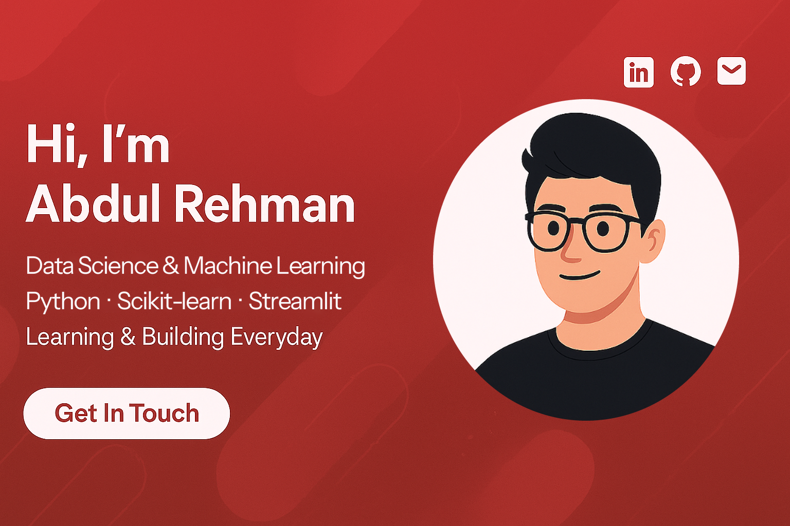
  </a>
</p>

<p align="center">
  <a href="https://linkedin.com/in/abdulrehman1718/"></a>
  <a href="https://www.kaggle.com/abdulrehman1718"></a>
  <a href="https://abdulrehmanweb.vercel.app"></a>
  <a href="mailto:abdulrehmanbey1718@gmail.com"></a>
</p>

<br/>

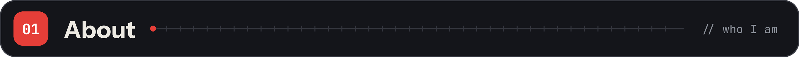

```python
abdul = {
    "role":      "Aspiring Data Scientist & AI Engineer",
    "based_in":  "Karachi, Pakistan",
    "studying":  "BS Software Engineering @ University of Karachi (UBIT)",
    "training":  "Diploma in Advancement in AI (Level 4) @ Alnafi",
    "background": "Web developer who learned to ship models, not just train them",
    "focus":     ["data cleaning", "EDA", "classical ML", "deployment"],
    "learning":  ["TensorFlow / Keras", "CNNs", "LLMs", "RAG"],
    "open_to":   "AI / Data Science internships (remote, on-site or hybrid)",
}
```

I work across the whole pipeline: sourcing and cleaning data, exploratory analysis, feature engineering, modeling, evaluation, and deployment. A model only counts once someone can use it.

<br/>

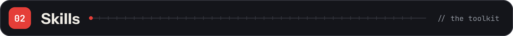
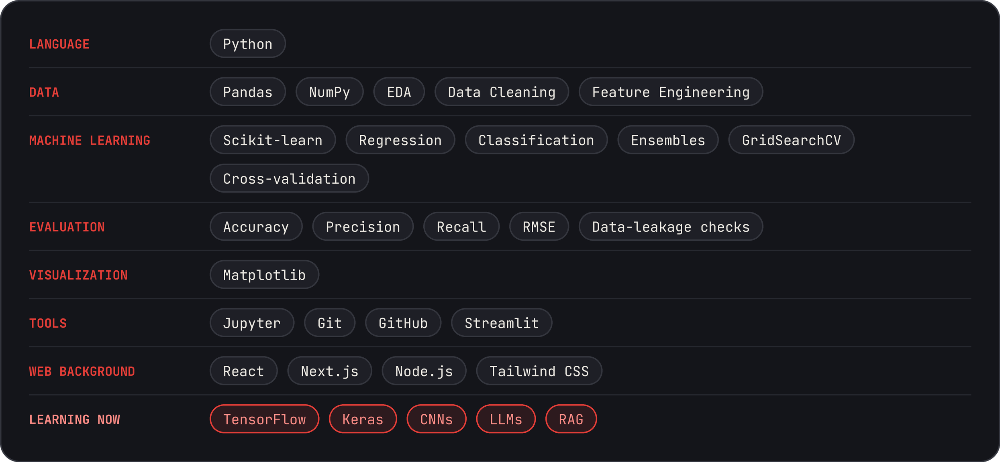

<br/>

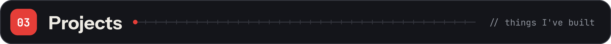

<p align="center">
  <a href="https://github.com/AbdulRehman817/Air_Quality_Prediction">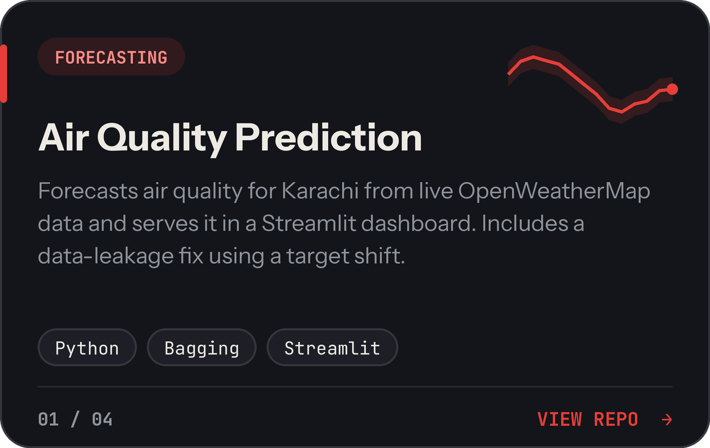</a>
  <a href="https://github.com/AbdulRehman817/Heart-Disease-Prediction-App">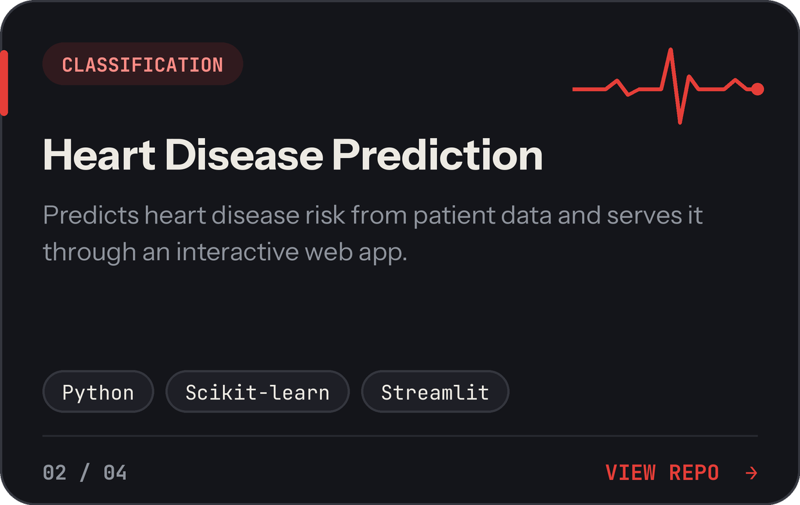</a>
</p>
<p align="center">
  <a href="https://github.com/AbdulRehman817/RainFall_Prediction_Project">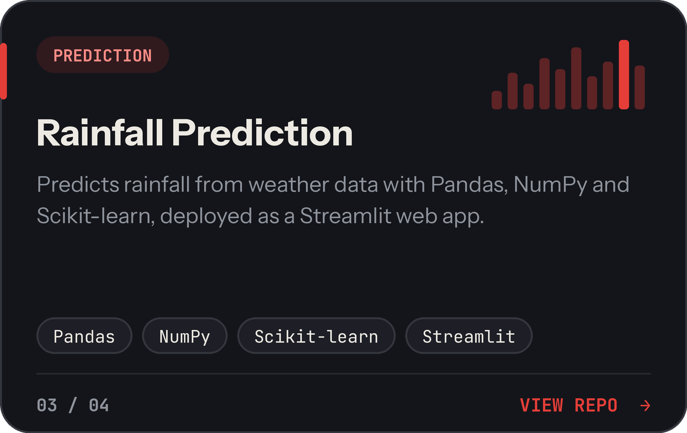</a>
  <a href="https://www.kaggle.com/abdulrehman1718">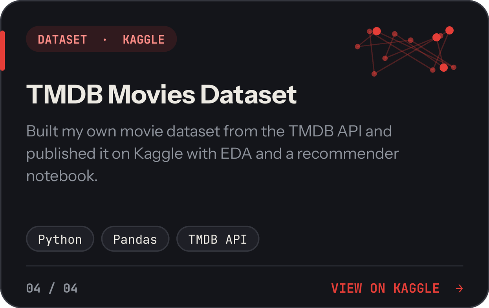</a>
</p>

<p align="center"><sub>Also built: loan prediction (GridSearchCV + ensembles) and analyses on Titanic, Ford car prices, Netflix and insurance costs.</sub></p>

<br/>

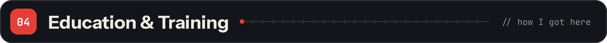
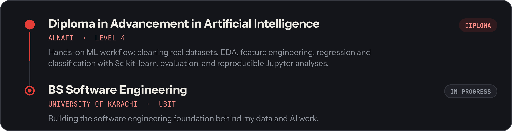

<br/>


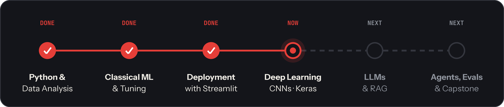

<br/>

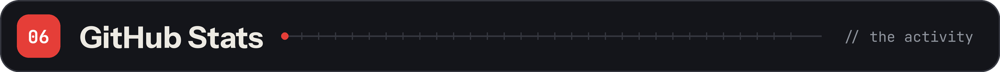

<p align="center">
  
  
</p>

<br/>

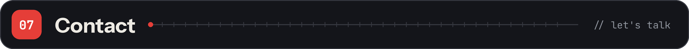
<a href="mailto:abdulrehmanbey1718@gmail.com"></a>
