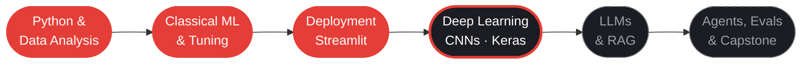

<p align="center">
  <a href="mailto:abdulrehmanbey1718@gmail.com">
    
  </a>
</p>

<h3 align="center">Turning raw data into models that ship.</h3>

<p align="center">
  <a href="https://linkedin.com/in/abdulrehman1718/"></a>
  <a href="https://www.kaggle.com/abdulrehman1718"></a>
  <a href="https://abdulrehmanweb.vercel.app"></a>
  <a href="mailto:abdulrehmanbey1718@gmail.com"></a>
</p>

<p align="center">
  <a href="#about">About</a> &nbsp;·&nbsp;
  <a href="#stack">Stack</a> &nbsp;·&nbsp;
  <a href="#projects">Projects</a> &nbsp;·&nbsp;
  <a href="#education">Education</a> &nbsp;·&nbsp;
  <a href="#roadmap">Roadmap</a> &nbsp;·&nbsp;
  <a href="#contact">Contact</a>
</p>

## About

```python
In [1]: whoami()
Out[1]: 'Abdul Rehman · aspiring Data Scientist & AI Engineer · Karachi, Pakistan'

In [2]: abdul.studying
Out[2]: 'BS Software Engineering @ University of Karachi (UBIT)'

In [3]: abdul.pipeline
Out[3]: ['source', 'clean', 'explore', 'model', 'evaluate', 'deploy']

In [4]: abdul.learning_now
Out[4]: ['TensorFlow / Keras', 'CNNs', 'LLMs', 'RAG']
```

I started in web development, so I don't stop at the notebook. I take a model from raw data all the way to a deployed app that someone can actually use.

> [!NOTE]
> **Open to AI / Data Science internships** — remote, on-site or hybrid. [Get in touch](mailto:abdulrehmanbey1718@gmail.com)

## Stack

<table width="100%">
  <tr>
    <td width="22%"><b>Language</b></td>
    <td></td>
  </tr>
  <tr>
    <td width="22%"><b>Data & analysis</b></td>
    <td>   </td>
  </tr>
  <tr>
    <td width="22%"><b>Machine learning</b></td>
    <td></td>
  </tr>
  <tr>
    <td width="22%"><b>Deployment</b></td>
    <td></td>
  </tr>
  <tr>
    <td width="22%"><b>Version control</b></td>
    <td> </td>
  </tr>
  <tr>
    <td width="22%"><b>Web background</b></td>
    <td>   </td>
  </tr>
  <tr>
    <td width="22%"><b>Learning now</b></td>
    <td>   </td>
  </tr>
</table>

**Methods:** data cleaning · EDA · feature engineering · regression & classification · ensembles · GridSearchCV · cross-validation · evaluation (accuracy, precision, recall, RMSE) · data-leakage checks

## Projects

<table>
  <tr>
    <td width="50%" valign="top">
      <h3><a href="https://github.com/AbdulRehman817/Air_Quality_Prediction">Air Quality Prediction</a></h3>
      <sub><b>FORECASTING</b> &nbsp;·&nbsp; live API &nbsp;·&nbsp; dashboard</sub><br/>
      <p>Forecasts air quality for Karachi from live OpenWeatherMap data and serves it in a Streamlit dashboard. Includes a data-leakage fix using a target shift.</p>
        
    </td>
    <td width="50%" valign="top">
      <h3><a href="https://github.com/AbdulRehman817/Heart-Disease-Prediction-App">Heart Disease Prediction</a></h3>
      <sub><b>CLASSIFICATION</b> &nbsp;·&nbsp; healthcare &nbsp;·&nbsp; web app</sub><br/>
      <p>Predicts heart disease risk from patient data and serves the model through an interactive web app.</p>
        
    </td>
  </tr>
  <tr>
    <td width="50%" valign="top">
      <h3><a href="https://github.com/AbdulRehman817/RainFall_Prediction_Project">Rainfall Prediction</a></h3>
      <sub><b>PREDICTION</b> &nbsp;·&nbsp; weather data &nbsp;·&nbsp; web app</sub><br/>
      <p>Predicts rainfall from weather data with Pandas, NumPy and Scikit-learn, deployed as a Streamlit web app.</p>
        
    </td>
    <td width="50%" valign="top">
      <h3><a href="https://www.kaggle.com/abdulrehman1718">TMDB Movies Dataset</a></h3>
      <sub><b>DATASET</b> &nbsp;·&nbsp; Kaggle &nbsp;·&nbsp; recommender</sub><br/>
      <p>Built my own movie dataset from the TMDB API and published it on Kaggle with an EDA and a recommender notebook.</p>
        
    </td>
  </tr>
</table>

<sub>Also built: loan prediction (GridSearchCV + ensembles) and analyses on Titanic, Ford car prices, Netflix and insurance costs.</sub>

## Education

<table width="100%">
  <tr>
    <td width="38%" valign="top"><b>Diploma in Advancement in Artificial Intelligence (Level 4)</b><br/>Alnafi</td>
    <td valign="top">Hands-on ML workflow: cleaning real datasets, EDA, feature engineering, regression and classification with Scikit-learn, evaluation, and reproducible Jupyter analyses.</td>
  </tr>
  <tr>
    <td width="38%" valign="top"><b>BS Software Engineering</b><br/>University of Karachi (UBIT)</td>
    <td valign="top">In progress. The engineering foundation behind my data and AI work.</td>
  </tr>
</table>

## Roadmap



## Snapshot

<table width="100%">
  <tr>
    <td align="center" width="25%"><h3>86</h3><sub>public repos</sub></td>
    <td align="center" width="25%"><h3>3</h3><sub>deployed ML apps</sub></td>
    <td align="center" width="25%"><h3>1</h3><sub>Kaggle dataset</sub></td>
    <td align="center" width="25%"><h3>8</h3><sub>ML projects built</sub></td>
  </tr>
</table>

## Contact

> [!TIP]
> Got a dataset, an internship, or an idea? I reply fastest by email: **abdulrehmanbey1718@gmail.com**

<p align="center">
  <a href="mailto:abdulrehmanbey1718@gmail.com"></a>
</p>
