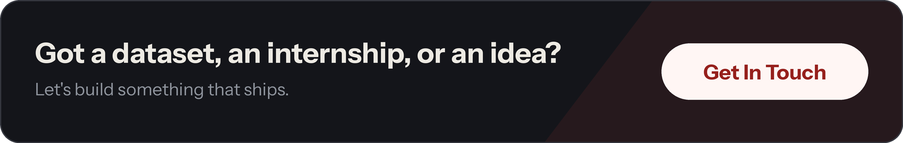

  

  <a href="https://linkedin.com/in/abdulrehman1718/"><b>LinkedIn</b></a> &nbsp;·&nbsp;
  <a href="https://www.kaggle.com/abdulrehman1718"><b>Kaggle</b></a> &nbsp;·&nbsp;
  <a href="https://abdulrehmanweb.vercel.app"><b>Portfolio</b></a> &nbsp;·&nbsp;
  <a href="mailto:abdulrehmanbey1718@gmail.com"><b>Email</b></a>

  
  

  
  

Also built: loan prediction (GridSearchCV + ensembles) and analyses on Titanic, Ford car prices, Netflix and insurance costs.

